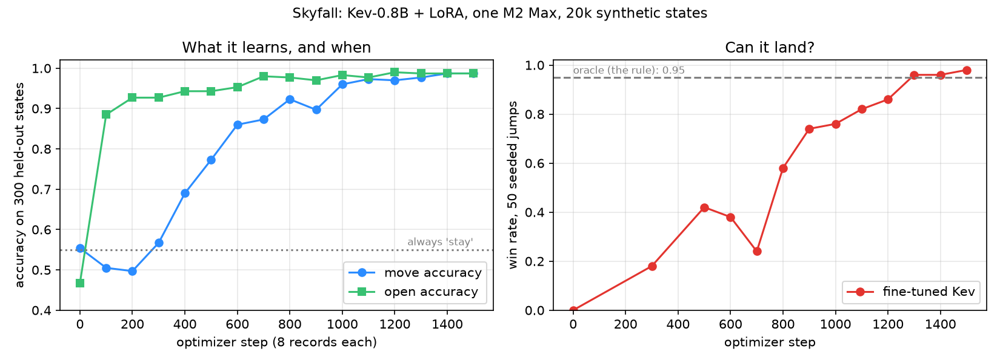

# Results

## Before and after (held-out states; live jumps on seeds 8000–8049)

| model | move acc | open acc | move Brier | open Brier | win rate |
|---|---|---|---|---|---|
| released Kev-0.8B, zero-shot | 0.554 | 0.467 | 0.626 | 0.506 | 0.00 (0/200) |
| fine-tuned, step 1500 | 0.987 | 0.987 | 0.016 | 0.009 | 0.98 (50 jumps) |
| oracle (the rule) | 1.000 | 1.000 | 0 | 0 | 0.95 (500 jumps) |

Zero-shot numbers: full `kev.benchmark` on 2,000 states. Fine-tuned: 300 states via `model/eval.py` (final: see `runs/ft-eval/report.json` if present).

## Learning curve

| step | records | move acc | open acc | move Brier | win rate (50 jumps) |
|---|---|---|---|---|---|
| 100 | 800 | 0.505 | 0.885 | 0.613 | |
| 200 | 1,600 | 0.497 | 0.927 | 0.612 | |
| 300 | 2,400 | 0.567 | 0.927 | 0.531 | 0.18 |
| 400 | 3,200 | 0.690 | 0.943 | 0.369 | |
| 500 | 4,000 | 0.773 | 0.943 | 0.279 | 0.42 |
| 600 | 4,800 | 0.860 | 0.953 | 0.209 | 0.38 |
| 700 | 5,600 | 0.873 | 0.980 | 0.214 | 0.24 |
| 800 | 6,400 | 0.923 | 0.977 | 0.129 | 0.58 |
| 900 | 7,200 | 0.897 | 0.970 | 0.177 | 0.74 |
| 1000 | 8,000 | 0.960 | 0.983 | 0.065 | 0.76 |
| 1100 | 8,800 | 0.973 | 0.977 | 0.053 | 0.82 |
| 1200 | 9,600 | 0.970 | 0.990 | 0.056 | 0.86 |
| 1300 | 10,400 | 0.977 | 0.987 | 0.044 | 0.96 |
| 1400 | 11,200 | 0.987 | 0.987 | 0.026 | 0.96 |
| 1500 | 12,000 | 0.987 | 0.987 | 0.016 | 0.98 |

## race-base-vs-gemini-lite.md

Latency is per decision (both questions). `seconds_per_jump` is the time the skydiver spends in the air if the sky waits for each decision. `rows_fallen_while_thinking` assumes a row every 100 ms. Kev tokens are priced at Jev list price ($0.042/M input, output free); Gemini at its list price. Accuracy is agreement with the oracle on the states actually visited.

| player | win_rate | move_acc | open_acc | latency_ms_p50 | latency_ms_p95 | seconds_per_jump | rows_fallen_while_thinking | tokens_in_per_decision | tokens_out_per_decision | usd_per_1000_decisions |
|---|---|---|---|---|---|---|---|---|---|---|
| oracle | 1.00 | 1.00 | 1.00 | 0 | 0 | 0.0 | 0.0 | 0 | 0 | 0.0000 |
| kev-base | 0.00 | 0.80 | 0.00 | 280 | 474 | 0.3 | 3.0 | 179 | 84 | 0.0075 |
| gemini:gemini-flash-lite-latest | 0.00 | 0.37 | 1.00 | 745 | 914 | 3.1 | 7.5 | 198 | 14 | 0.0704 |

## Gemini prompt variants (gemini-flash-lite-latest, thinking none, 60 held-out states)

| prompt | move acc | open acc | p50 ms |
|---|---|---|---|
| minimal | 0.33 | 0.82 | 719 |
| rules | 0.43 | 0.93 | 694 |
| procedure | 0.45 | 0.92 | 741 |
| procedure (gemini-3.1-flash-lite, thinking minimal) | 0.37 | 0.97 | 1029 |
| cot (gemini-flash-lite-latest, thinking none) | 0.70 | 1.00 | 896 |
